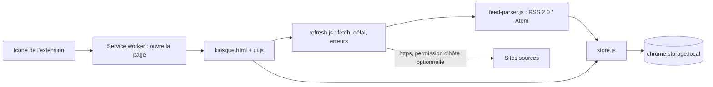

# Kiosque — Architecture technique

> Version 1 · 2026-10-17

## 1. Résumé

| Couche | Choix | Pourquoi | Alternative écartée |
|---|---|---|---|
| Interface | Une page d'extension (`kiosque.html`) en HTML, CSS et JavaScript natifs (modules ES) | Aucune exigence du MVP ne justifie un framework ; peu de code, pas d'étape de build | React + Vite : outillage et dépendances sans bénéfice pour 2 écrans |
| Logique | Modules purs (`feed-parser`, `store`, `refresh`) séparés des API Chrome | Testables sans navigateur | Logique mêlée à l'interface : tests difficiles |
| Stockage | `chrome.storage.local` | 10 Mo suffisent pour 30 sources × 100 articles courts **[H5]**, API simple | IndexedDB : plus lourd, utile seulement si le volume grossit ; `storage.sync` : 100 Ko, inadapté |
| Serveur / services | Aucun | Données non partagées, aucune clé secrète, rien à exécuter hors présence de l'utilisateur | Serveur d'agrégation : coût, vie privée, contraire à la proposition de valeur |
| Tests | Vitest + jsdom | Modules ES et DOM simulé (analyse XML, rendu) | `node:test` : pas de DOM prêt à l'emploi |
| Distribution | « Charger l'extension non empaquetée » d'abord ; Chrome Web Store éventuel | Usage personnel d'abord **[H3]** | Publication immédiate : exigences inutiles à ce stade |

## 2. Contexte existant

Nouveau projet, aucun code existant. Chrome et navigateurs Chromium, Manifest V3 **[H2]**, usage personnel **[H3]**, confirmés par l'utilisateur (obligatoire pour toute nouvelle extension, d'après la référence du skill, non revérifiée dans cette session).

## 3. Composants



- **Service worker** (`background.js`) : un seul rôle, ouvrir la page au clic sur l'icône. Sans état (il peut s'arrêter à tout moment).
- **Page** (`kiosque.html`, `ui.js`) : rendu du fil et des sources, gestes de l'utilisateur, demande de permission.
- **`refresh.js`** : récupération des flux depuis la page (une page d'extension au premier plan peut interroger des serveurs externes avec des permissions d'hôte, source du brief), délai, taille maximale, concurrence.
- **`feed-parser.js`** : analyse XML avec `DOMParser` (disponible dans une page, pas dans un service worker) **[À vérifier]** dans Chrome à l'implémentation ; normalise en articles.
- **`store.js`** : seul module qui lit et écrit `chrome.storage.local`.

## 4. Local ou serveur

| Fonction | Où elle s'exécute | Service externe | Clé secrète | Repli si indisponible |
|---|---|---|---|---|
| Récupération des flux | Local (page de l'extension) | Les sites sources eux-mêmes | Non | Erreur par source, articles stockés conservés (AC-F3-3, AC-F3-6) |
| Analyse, tri, filtre, lu/non lu | Local | Aucun | Non | Sans objet |
| Stockage | Local | Aucun | Non | Message d'erreur si le quota est dépassé (R5) |
| Ouverture de la page | Local (service worker) | Aucun | Non | Sans objet |

Contrainte retenue « aucun coût récurrent, aucun service tiers » : respectée sur chaque ligne.

## 5. Modèle de données

Stockage `chrome.storage.local`, trois clés, version de format `schemaVersion: 1` pour permettre une migration.

```
schemaVersion: 1
sources: [ { id, url, origin, title, addedAt, lastFetchedAt, lastError } ]   // 30 au plus
items:   { <itemId>: { id, sourceId, title, link, publishedAt, fetchedAt,
                       excerpt, read } }                                      // 100 par source au plus
meta:    { lastRefreshAt }
```

- `id` d'une source : identifiant aléatoire ; `origin` : schéma + hôte, sert à la demande de permission.
- `itemId` : `sourceId` + identifiant du flux (guid ou id Atom), à défaut le lien.
- `excerpt` : texte brut, 200 caractères au plus à l'affichage (stockage plafonné à 300). Autres bornes : titre 300, lien 1 000, identifiant d'article 200 caractères (au-delà, empreinte courte).
- Volume mesuré en test (2026-10-17) : 2,14 Mio pour 30 × 100 articles réalistes, 6,36 Mio dans le pire cas permis par les bornes **[H5]**, sous la limite de 10 Mo de `chrome.storage.local` (limite issue de la référence du skill, non revérifiée dans la documentation actuelle).
- Durée de conservation : jusqu'à suppression de la source ou rotation à 100 articles. Les données sont **effacées à la désinstallation** (R2).

## 6. Interfaces et intégrations

- **Entrée externe** : flux RSS 2.0 et Atom 1.0 en https, texte XML ≤ 2 Mo. RSS 1.0 (RDF) : non pris en charge dans le MVP. Les flux de recherche Google News (Reuters, AP) sont du RSS 2.0 ordinaire ; leur URL contient une chaîne de requête (`+`, `:`, `&`) qui doit être conservée telle quelle (H8).
- **Messages internes** : aucun message entre composants (la page lit et écrit directement via `store.js`).
- **Export/import** : aucun dans le MVP (F5 en V2).

## 7. Authentification et permissions

Sans objet : pas de compte. Permissions détaillées dans `FEATURES_AND_ACCEPTANCE.md`, section 5. Manifeste minimal :

```json
{
  "manifest_version": 3,
  "name": "Kiosque",
  "version": "0.1.0",
  "action": { "default_title": "Ouvrir Kiosque" },
  "background": { "service_worker": "src/background.js", "type": "module" },
  "permissions": ["storage"],
  "optional_host_permissions": ["https://*/*"]
}
```

L'autorisation d'un site précis se demande avec `chrome.permissions.request` dans le geste de l'utilisateur (clic sur « Ajouter »), la demande devant rester dans les motifs déclarés en optionnel (source du brief).

## 8. Sécurité, validation et erreurs

- **Frontières validées** : URL saisie (https, URL valide, normalisée) ; réponse réseau (statut, taille ≤ 2 Mo, délai 10 s, contenu analysable) ; contenu du flux (liens http/https seulement, titres non vides).
- **Sorties** : tout texte issu d'un flux est inséré avec `textContent`, jamais `innerHTML`. La politique de sécurité par défaut des pages d'extension MV3 (scripts de l'extension seulement) n'est pas assouplie. Aucune image distante.
- **Aucun code distant** : tout le code est dans le paquet.
- **Liens** : `rel="noopener noreferrer"`, nouvel onglet.
- **Secrets** : sans objet (aucune clé). Pas de `.env`.
- **Erreurs** : message lisible par source, détail technique dans `console.error` ; une erreur d'une source n'interrompt pas les autres ; écriture du stockage par source terminée, jamais d'état partiel d'une source.
- **Redirections** : un flux qui redirige vers un autre domaine échoue avec un message explicite (permission non accordée à ce domaine) ; comportement exact **[À vérifier]** (R1, décision D5).

## 9. Dépendances

| Dépendance | Rôle | Licence | Coût | Alternative |
|---|---|---|---|---|
| Aucune à l'exécution | — | — | 0 | — |
| Vitest 5.0.5 (développement) | Tests | MIT (vérifié dans le paquet installé, 2026-10-17) | 0 | `node:test` |
| jsdom 30.1.3 (développement) | DOM simulé pour les tests | MIT (vérifié dans le paquet installé, 2026-10-17) | 0 | `happy-dom` |

## 10. Tests

Vitest + jsdom ; API `chrome.*` simulées par un petit module `tests/chrome-mock.js`. Niveaux : unitaire (analyse, stockage, récupération, rendu), manuel dans Chrome (M1 à M5). **Commande unique** : `npm test`. Détail dans `RISKS_AND_TESTS.md`.

## 11. Build, déploiement et maintenance

Aucun build : le dossier du projet est chargé tel quel via `chrome://extensions` → « Charger l'extension non empaquetée ». Archive `.zip` du dossier pour une publication éventuelle. Maintenance : surveiller les changements de la plateforme Chrome (permissions, service worker) et les flux qui changent d'adresse.

## 12. Coûts récurrents

| Poste | Coût | Source |
|---|---|---|
| Hébergement, base, API | 0 | Aucun service utilisé |
| Compte développeur Chrome Web Store (publication seulement) | Frais d'inscription éventuels | **[À vérifier]** au moment de publier |

## 13. Décisions d'architecture

- **ADR-1 — Page ouverte au clic sur l'icône, pas de popup** : une popup se ferme au moindre clic extérieur et interrompt une actualisation ; une page dans un onglet permet lecture longue et filtres. Conséquence : un service worker minimal est nécessaire.
- **ADR-2 — Permissions d'hôte optionnelles, https seulement** : évite l'avertissement d'installation de la permission globale ; les flux en http sont refusés (limite assumée).
- **ADR-3 — Récupération depuis la page, pas depuis le service worker** : `DOMParser` y est disponible et l'état n'est pas perdu à l'arrêt du service worker. Conséquence : pas d'actualisation quand la page est fermée (V2 : F8).
- **ADR-4 — JavaScript natif sans bundler** : moins de dépendances, pas de build. Conséquence : types vérifiés par JSDoc et tests seulement.
- **ADR-5 — Pas de contenu HTML ni d'image du flux** : supprime la surface XSS et le pistage par pixel. Conséquence : affichage sobre (titre, extrait en texte brut).
- **ADR-6 — Page « Actualités » à sources fixes (2026-10-17)** : sans formulaire d'ajout, une demande de permission au clic n'existe plus. Les 11 sites des 16 sources par défaut sont donc déclarés dans `host_permissions` (liste dans `src/lib/default-sources.js`, cohérence vérifiée par un test). Cela remplace l'ADR-2 pour la page par défaut ; `optional_host_permissions` reste déclaré pour l'ancienne page de gestion. Conséquence : ajouter un site demande de modifier le code et le manifeste ; Chrome affiche la liste des 11 sites à l'installation d'une version publiée (pas en mode développeur).

## 14. Arborescence proposée

```
kiosque/
├─ manifest.json
├─ package.json            # scripts : test ; devDependencies : vitest, jsdom
├─ vitest.config.js
├─ README.md               # installation, test, chargement dans Chrome, avertissement sur la désinstallation
├─ .gitignore
├─ src/
│  ├─ background.js
│  ├─ kiosque.html
│  ├─ kiosque.css
│  ├─ ui.js
│  └─ lib/
│     ├─ feed-parser.js
│     ├─ store.js
│     ├─ refresh.js
│     └─ url.js            # validation et normalisation des URL
├─ icons/                  # 16, 48, 128 px
├─ tests/
│  ├─ chrome-mock.js
│  ├─ fixtures/            # flux RSS, Atom, HTML, flux hostile
│  └─ *.test.js
└─ product/                # ces documents
```
